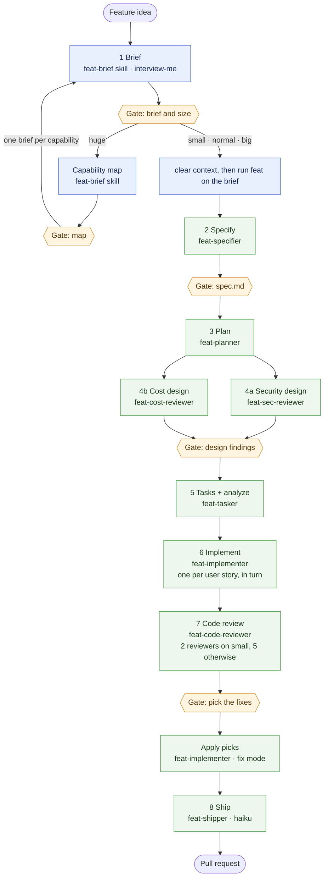

# feat-agents

A Claude Code workflow that takes a feature idea to a reviewed pull request,
in two commands: `/feat-brief "let users edit a stack's config"` interviews
you and writes a brief; `/clear`, then `/feat specs/briefs/<name>.md`
specifies, plans, reviews, breaks down, implements and code-reviews it with
[Spec Kit](https://github.com/github/spec-kit), then commits, pushes and
opens a PR on its own branch. You approve the decisions that shape the
feature at a few gates; everything else runs on its own.

`/feat` only coordinates: every phase runs in a dedicated `feat-*` subagent
whose model and effort follow the feature's size (Sonnet at medium effort
for most of a small feature, Opus at higher effort where a big one needs
it). Keeping the coordinator's context small is what keeps the token count
down on a plan with a usage limit. A huge idea is split into a capability
map, one brief and PR per capability.



Blue runs in your session, green in a subagent, orange hexagons are hard
gates. Branches out of one box run in parallel. The phase 4 gate is soft for
a small feature without real findings. Phases 3, 5 and each story of 6 also
stop for a big feature. Phase 7's lenses: correctness/spec/standards,
security, performance, over-engineering, readability. Full matrix in
[docs/workflow.md](docs/workflow.md).

## Quick start

```sh
git clone <this repo> ~/Projects/feat-agents
cd ~/Projects/feat-agents
./install.sh            # link the skills and agents into ~/.claude
./install.sh deps       # install the third-party skills they use
cd ~/your-project
specify init --here --integration claude   # once per project, if not already
~/Projects/feat-agents/install.sh check .  # everything should say ok
claude
> /feat-brief "describe the feature in one line"
> /clear
> /feat specs/briefs/<name>.md
```

## Documentation

| Doc | What's in it |
|---|---|
| [docs/install.md](docs/install.md) | Prerequisites, every dependency and where it comes from, install options, uninstall |
| [docs/usage.md](docs/usage.md) | Brief, build, answering gates, resuming, changing size, tuning models and effort |
| [docs/workflow.md](docs/workflow.md) | Every phase, gate and agent: the size × phase matrix, what runs when and how |
| [docs/design.md](docs/design.md) | Why it is built this way: Claude Code mechanics, rejected alternatives |
| the cost notes (since moved out) | Measuring a run's tokens and cost with a cost script (since moved out); the baseline to compare against |

## Layout

```
skills/feat/SKILL.md   the orchestrator: phases, gates, size table (source of truth)
agents/feat-*.md       one subagent per phase role; frontmatter defaults = small size
install.sh             install, deps, check, uninstall
a cost script (since moved out)          tokens and $ of a run, per phase and model, from Claude Code transcripts
docs/                  the documentation above
```

## Status

Version 0.1.0. Tested with Claude Code 2.1.308 and Spec Kit (specify-cli)
1.2.x. See [CHANGELOG.md](CHANGELOG.md).

## License

MIT, see [LICENSE](LICENSE). The capability-map rules in `skills/feat-brief`
are adapted from addyosmani/agent-skills (MIT), and two checklists in
`agents/feat-code-reviewer.md` from MIT skills: standards and spec review
from mattpocock/skills' `code-review`, over-engineering from
dietrichgebert/ponytail's pre-v5 `ponytail-review`. Third-party skills installed
by `install.sh deps` keep their own licenses.
