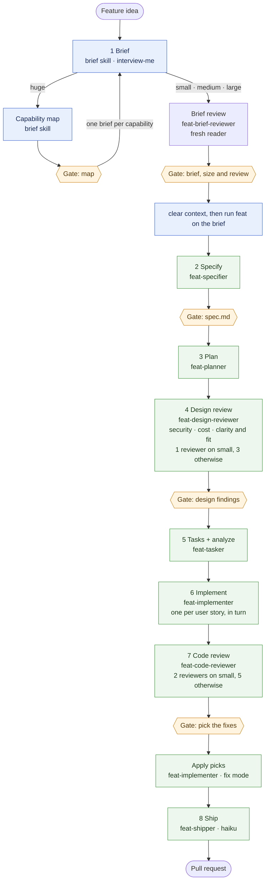

# feat-agent

### From idea to merge-ready PR on autopilot: an AI engineering team in your terminal, with spec-driven planning, right-sized models and smart gates that only stop you when it matters.

A Claude Code workflow that takes a feature idea to a reviewed pull request,
in two commands: `/brief "let users edit a stack's config"` interviews
you and writes a brief; `/clear`, then `/feat specs/briefs/<name>.md`
specifies, plans, reviews, breaks down, implements and code-reviews it with
[Spec Kit](https://github.com/github/spec-kit), then commits, pushes and
opens a PR on its own branch. You approve the decisions that shape the
feature at a few gates; everything else runs on its own.

`/feat` only coordinates: every phase runs in a dedicated `feat-*` subagent
whose model and effort follow the feature's size (Sonnet at medium effort
for most of a small feature, Opus at higher effort where a large one needs
it). Keeping the coordinator's context small is what keeps the token count
down on a plan with a usage limit. A huge idea is split into a capability
map, one brief and PR per capability.

Bugs take one command: `/fix #N` (or `/fix "<symptom>"`) assesses the
report with Spec Kit's bug extension, fixes it, has a different agent
verify the fix, code-reviews it and opens a PR with `Fixes #N`, through
the same gates, state file and board moves as `/feat`
([docs/workflow.md](docs/workflow.md#fix)).



Blue runs in your session, green in a subagent, orange hexagons are hard
gates. Branches out of one box run in parallel. Phase 4's clarity-and-fit
lens reads spec and plan as someone new to the project would: it paraphrases them for you to check,
then flags what is unclear, what the code contradicts, what already exists
and what is left for the implementer to decide. The phase 4 gate is soft for
a small feature without real findings. Phases 3, 5 and each story of 6 also
stop for a large feature. Phase 7's lenses: correctness/spec/standards,
security, performance, over-engineering, readability. Full matrix in
[docs/workflow.md](docs/workflow.md).

## Quick start

```sh
uv tool install apm-cli
apm install -g pdemagny/feat-agent -t claude  # skills, agents and their dependencies
cd ~/your-project
specify init --here --integration claude       # once per project, if not already
claude
> /brief "describe the feature in one line"
> /clear
> /feat specs/briefs/<name>.md
```

For a bug, once per project `specify extension add bug`, then:

```sh
> /fix #42                                       # or /fix "<symptom>"
```

Claude Code only: `/feat` relies on its subagents with a model and effort
per call, and on `EnterWorktree`. Besides APM there are two other ways to
install (a Claude Code plugin, or `install.sh` from a clone), and a check
for any of them: [docs/install.md](docs/install.md).

## Documentation

| Doc | What's in it |
|---|---|
| [docs/install.md](docs/install.md) | Prerequisites, the three ways to install, dependencies, board tracking setup, update, uninstall |
| [docs/usage.md](docs/usage.md) | Brief, build, fixing a bug, answering gates, resuming, changing size, tuning models and effort |
| [docs/workflow.md](docs/workflow.md) | Every phase, gate and agent: the size × phase matrix, what runs when and how |
| [docs/design.md](docs/design.md) | Why it is built this way: Claude Code mechanics, rejected alternatives |
| [Roadmap](https://github.com/users/pdemagny/projects/2) | Known bugs and what is planned |
| [CONTRIBUTING.md](CONTRIBUTING.md) | Reporting bugs, proposing changes, working on feat-agent |
| [SECURITY.md](SECURITY.md) | Reporting a vulnerability privately |

## Layout

```
.apm/skills/feat/        the orchestrator: phases, gates, size table (source of truth)
.apm/skills/feat/scripts/  tracker.sh: optional GitHub Projects board moves
.apm/skills/feat/references/  harness.md: the rules /feat and /fix share (gates, state file, board, resume)
.apm/skills/fix/         the bugfix orchestrator: assess, fix, test, review, ship; its own size table
.apm/skills/brief/  phase 1: interview, size, brief or capability map
.apm/agents/*.agent.md   one subagent per phase role
apm.yml                  APM package: metadata and the third-party skill dependencies
.claude-plugin/          Claude Code plugin and marketplace manifests
install.sh               developer install (symlinks), deps, check, uninstall
tests/tracker/           offline tests for tracker.sh (stub gh, fake GraphQL endpoint)
mise.toml                pinned tools and tasks (lint, check, test:apm, test:tracker, pin)
docs/                    the documentation above
```

## Status

Version 0.8.0. Tested with Claude Code 2.1.308 and Spec Kit (specify-cli) <!-- x-release-please-version -->
1.2.x. See [CHANGELOG.md](CHANGELOG.md).

## License

MIT, see [LICENSE](LICENSE). The capability-map rules in `.apm/skills/brief`
are adapted from addyosmani/agent-skills (MIT), and three checklists in
`.apm/agents/feat-code-reviewer.agent.md` from MIT skills: standards and spec review
from mattpocock/skills' `code-review` (Matt Pocock), over-engineering from
dietrichgebert/ponytail's pre-v5 `ponytail-review` (Dietrich Gebert),
readability from addyosmani/agent-skills' `code-simplification` (Addy
Osmani, itself inspired by Anthropic's code-simplifier plugin). The passes of
`.apm/agents/feat-design-reviewer.agent.md` and
`.apm/agents/feat-brief-reviewer.agent.md` are adapted, condensed and
changed, from the reviewer prompts, brainstorm lenses and document
standards of google/elephant-goldfish-model (Apache-2.0). Third-party skills installed
by `install.sh deps` keep their own licenses.
