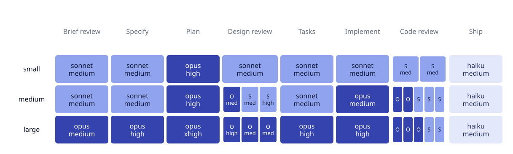

# The workflow in detail

What runs at each phase, on which model, for which size, and where it stops
for you. The size table in [`.apm/skills/feat/SKILL.md`](https://github.com/pdemagny/logistics/blob/main/.apm/skills/feat/SKILL.md)
is authoritative; this page mirrors it with explanations.

## Roles

- **`/brief`**: phase 1, in its own context. Interviews you, proposes
  the size, writes the brief (or a capability map for huge ideas) and has
  `feat-brief-reviewer` read it fresh before you confirm it.
- **Coordinator**: the session running `/feat`, started from a clean
  context. It holds every gate and edits only `feat-state.md`; it never
  reads code, runs checks or edits artifacts, and it runs git only to
  compare bases and find runs. Every call it makes re-reads
  its whole context, so it stays thin on purpose.
- **Phase agents**: the `feat-*` subagents. Each does one job, can't talk to
  you, starts with no conversation history, and gets what it needs (paths,
  size, conventions, allowed hooks, rejected findings) in its prompt.
  Changes you ask for at a gate go back to the agent that owns the artifact.

## Phases at a glance

| # | Phase         | Runs in                                                                               | Skills used                                                        | Produces                                      | Gate                                                                                                                       |
| - | ------------- | ------------------------------------------------------------------------------------- | ------------------------------------------------------------------ | --------------------------------------------- | -------------------------------------------------------------------------------------------------------------------------- |
| 1 | Brief         | `/brief` (your session), then `feat-brief-reviewer`                                   | `interview-me`                                                     | `specs/briefs/<name>.md`, or a capability map | **hard** (confirm the brief and the review's findings)                                                                     |
| 0 | Setup         | coordinator                                                                           | —                                                                  | conventions, hooks checked                    | hard only if a Spec Kit hook would branch or commit                                                                        |
| 2 | Specify       | `feat-specifier`                                                                      | `speckit-specify`                                                  | branch/worktree, `spec.md`, `feat-state.md`   | **hard** only on an open question or a blocker; else soft, and its summary opens the next gate                              |
| 3 | Plan          | `feat-planner`                                                                        | `speckit-plan`                                                     | `plan.md` and design docs                     | none (hard for large, opening with the spec summary after a soft phase 2)                                                  |
| 4 | Design review | `feat-design-reviewer` ×1 (small) or ×3, then `feat-planner` writes accepted findings | `security-and-hardening` (cost and design checklists in the agent) | a paraphrase, findings D1…                    | one gate with 3: hard only on a real finding, a user-call assumption, a constitution violation, a blocker, a size increase, a paraphrase that contradicts the brief or an unchecked checklist item after a soft phase 2 (always hard for large) |
| 5 | Tasks         | `feat-tasker`                                                                         | `speckit-tasks`, `speckit-analyze`                                 | `tasks.md`, analysis clean                    | hard on CRITICAL/HIGH, a size increase or an unanswered checklist item; always for large                                   |
| 6 | Implement     | `feat-implementer` ×1 per user story, in turn                                         | `speckit-implement`                                                | the code, tasks ticked when their checks ran, a Not verified list | soft (hard per story for large; hard on a design problem)                                                                  |
| 7 | Code review   | `feat-code-reviewer` ×2 (small) or ×5, then `feat-implementer` applies the fixes         | `security-and-hardening`, `performance-optimization`               | findings B, S, P, C, R with recommendations; fixes applied | small/medium: **hard** on a finding that needs you (`user`), an `S` finding or an unmet criterion, else soft; large: **hard** |
| 8 | Ship          | `feat-shipper`                                                                        | —                                                                  | docs updated, commits, push, PR               | none                                                                                                                       |

**Hard gate**: Claude stops and waits for your answer. **Soft gate**: Claude
reports and continues; anything surprising turns it into a hard gate.
Every agent's report ends with a `Wrote:` line (its artifacts and the
files it wrote, or `none`). Before it accepts the report, the coordinator
refuses any path that is not absolute, is outside the worktree, or holds a
quote, newline, `$` or backtick, then checks each path exists (`ls -d`,
never reading the files) and that the report's artifact path is on the
line. A failure fails the phase: a hard gate that shows the reason, with
no automatic retry ("back to N" reruns it).
After a soft phase 2, the next gate (3/4, or 3 on large) opens with the spec
summary.

From phase 3 on, each phase starts with the base check (see
[When main moves](#when-main-moves)): silent when main has not moved; a
move is listed at the next gate, or stops there when it needs your call.

## Size × phase matrix

Opus where judgment decides, Sonnet for the routine work, Haiku to ship. A
split cell is a phase whose reviewers run in parallel, one per group of
lenses (O = Opus, S = Sonnet). The picture is drawn from the size table by
`mise run diagrams`.

Each cell: model · effort, passed by `/feat` on every spawn.

| #  | Phase                        | Agent                  | small           | medium          | large           | huge                         |
| -- | ---------------------------- | ---------------------- | --------------- | --------------- | --------------- | ---------------------------- |
| 1  | Brief                        | your session           | session         | session         | session         | session, plus capability map |
| 1  | Brief review                 | `feat-brief-reviewer`  | sonnet · medium | sonnet · medium | opus · medium   | first capability's size      |
| 2  | Specify                      | `feat-specifier`       | sonnet · medium | sonnet · medium | opus · high     | —                            |
| 3  | Plan                         | `feat-planner`         | opus · high     | opus · high     | opus · xhigh    | —                            |
| 4a | Security design ∥            | `feat-design-reviewer` | sonnet · medium | opus · medium   | opus · high     | —                            |
| 4b | Cost design ∥                | `feat-design-reviewer` | sonnet · medium | sonnet · medium | opus · medium   | —                            |
| 4c | Clarity and fit ∥            | `feat-design-reviewer` | sonnet · medium | sonnet · high   | opus · medium   | —                            |
| 5  | Tasks + analyze              | `feat-tasker`          | sonnet · medium | sonnet · medium | opus · high     | —                            |
| 6  | Implement (×1 per story)     | `feat-implementer`     | sonnet · medium | opus · medium   | opus · high     | —                            |
| 7a | Correctness, spec, standards | `feat-code-reviewer`   | sonnet · medium | opus · medium   | opus · medium   | —                            |
| 7b | Security                     | `feat-code-reviewer`   | sonnet · medium | opus · medium   | opus · high     | —                            |
| 7c | Performance                  | `feat-code-reviewer`   | sonnet · medium | sonnet · medium | opus · medium   | —                            |
| 7d | Over-engineering             | `feat-code-reviewer`   | sonnet · medium | sonnet · medium | sonnet · medium | —                            |
| 7e | Readability                  | `feat-code-reviewer`   | sonnet · medium | sonnet · medium | sonnet · medium | —                            |
| 8  | Ship                         | `feat-shipper`         | haiku · medium  | haiku · medium  | haiku · medium  | —                            |

**Phase 4 reviewers.** small: one reviewer, lenses 4a+4b+4c. medium and
large: one reviewer per lens, in parallel.

**Phase 7 reviewers.** small: two reviewers, lenses 7a+7b and 7c+7d+7e. medium and large: one reviewer per lens, 7a–7d in parallel, then 7e
with 7d's cuts. A group runs on the strongest model and effort among its lenses.
Applying the review fixes and moving onto a new main use the phase 6 row.

A huge idea never reaches `/feat` as one unit: each capability of its map
gets its own brief and size column.

### How the sizes differ beyond model and effort

|                      | small                                                                                        | medium                                           | large                                                       | huge                                       |
| -------------------- | -------------------------------------------------------------------------------------------- | ------------------------------------------------ | ----------------------------------------------------------- | ------------------------------------------ |
| **When**             | up to ~30 tasks; no new service, permissions, network exposure or dependency; docs-only work | ~31–60 tasks, or a small one adding any of those | more than ~60 tasks                                         | capabilities that could ship independently |
| **Hard gates**       | brief, 7 (+2 on a question, +3/4 on a finding or checklist item, +5 on CRITICAL/HIGH, +7 on a finding that needs you) | brief, 7 (+2, +3/4, +5 and +7 as for small)    | brief, 3, 4, 5, each story in 6, 7 (+2 on a question)       | the map                                    |
| **Design reviewers** | 1                                                                                            | 3                                                | 3                                                           | per capability                             |
| **Code reviewers**   | 2                                                                                            | 5                                                | 5                                                           | per capability                             |
| **PRs**              | 1                                                                                            | 1                                                | 1                                                           | 1 per capability                           |
| **Extra review**     | —                                                                                            | —                                                | `/code-review ultra` suggested before merge (you launch it) | per capability                             |

### Why these choices

- **Plan is on Opus even for small.** Plan quality decides everything after
  it, and it is one agent run.
- **Effort before model.** Raising effort on the same model costs less than
  a bigger model, and pays off most in planning and review.
- **One implementer per story at every size.** Each starts fresh instead of
  carrying the earlier stories' reads; stories run one after the other
  because nothing is committed before phase 8.
- **One design reviewer and two code reviewers for small.** Each agent
  start costs ~36k tokens before any work; a small design doesn't need
  three separate contexts, nor a small diff five. Lens 4c stays a fresh
  reader either way: no design reviewer gets the planner's report.
- **A fresh reader on every brief.** One cheap spawn before anything is
  built; a wrong premise found in phase 4 has already cost a spec, a plan
  and the design reviews.
- **Ship on Haiku.** Commits, push and a PR body from the state file need
  little reasoning; it used to run at the coordinator's full context.
- **Huge is a scoping problem.** One spec with a dozen capabilities gives a
  shallow review and a PR nobody can read.

## Phase details

### 1 Brief (`/brief`)
Reads the code the idea touches, interviews you one question at a time
(`interview-me` steps 1–5; its restate is the brief, its confirmation the
gate, its hand-off step skipped), gives the strongest counter-argument to
each decision before writing it down, proposes a size and writes
`specs/briefs/<name>.md`: why, how it's handled today, behaviour, out of
scope, alternatives rejected with their reasons, acceptance, constraints.
From an issue (`/brief #N` or its URL) it reads the issue with `gh` as
the idea and records it in the brief; the shipper's PR says `Closes #N`.
With [board tracking](#board-tracking) it checks the board first, moves the
issue to Brief, and after the gate offers to create the issue when the
brief has none.

Then `feat-brief-reviewer` reads the brief with no knowledge of the
interview, as the specifier will, on every brief. It makes four passes:
- **clarity**: it paraphrases what the feature does, for whom and how it's
  handled today; the gate shows this so you can check it against what you
  meant;
- **yagni**: existing code, a dependency or a config option that already
  covers it (it searches and names the path), behaviour that could be
  dropped, a symptom fix, an obvious alternative neither chosen nor
  rejected;
- **gap**: undecided failure and edge cases, acceptance nobody could check,
  existing data or users the change affects, constraints the code
  contradicts, scope that leaks;
- **size**: its own task estimate; a higher size is asked, not applied.

Its passes are adapted from the brainstorm lenses and the Heilmeier and
feature-spec standards of the
[Elephant-Goldfish Model](https://github.com/google/elephant-goldfish-model)
(Apache-2.0). Findings `F…` come with recommendations; the accepted ones are
written into the brief, and a rejected "drop this" goes under "Alternatives
rejected" with your reason, which the specifier, planner and reviewers
treat as settled. Then it tells you to `/clear` and run `/feat` on it.
**Huge:** writes a capability map to `specs/maps/<name>.md` (stable ids,
responsibility, size, one-way dependencies, a build order where each step
ships something usable), gates on it, then writes the first capability's
brief. Detection rules and map format adapted from the scope check in
[addyosmani/agent-skills](https://github.com/addyosmani/agent-skills)'
`spec-driven-development` (MIT).

### 0 Setup (coordinator)
Checks the argument is a brief, reads `CLAUDE.md`/`AGENTS.md` and project
memory (they override the skill), checks Spec Kit and the agents, and reads
`.specify/extensions.yml`: hooks that would create branches or commit are
put to you before anything runs. With [board tracking](#board-tracking) it
runs the board check and moves the issue to In progress.

### 2 Specify (`feat-specifier`)
The coordinator fetches `origin/<default>` first, so the run starts from
the remote head rather than a stale local copy, then creates branch
`<short-name>` (worktree when possible,
renamed if EnterWorktree picked another name) and enters it, so every agent
starts there. The spec dir is `specs/<short-name>/` until phase 8 numbers it. The specifier runs `speckit-specify` from the brief and
reports stories, requirements, open `[NEEDS CLARIFICATION]` markers with
recommended answers, assumptions and unchecked checklist items. The
coordinator moves the brief into `feat-state.md` and gates. The gate is hard
only when the spec has an open marker or the specifier reports a blocker (or
the report holds something surprising, such as a remark about size), at
every size. Otherwise it is soft: one line, `Phase 2 Specify — soft`, and
the run goes on. The summary (stories, requirements, the specifier's
assumptions, unchecked checklist items) is kept in the state file's Log and
opens the next gate, so questions are asked at phase 2 or at the gate that
shows that summary, and later phases don't stop to ask. A hard phase 2 shows
the summary, each marker with a recommended answer, the assumptions and the
checklist question; your answers and edits go back to the specifier in amend
mode, spawned fresh (a subagent's cache lasts 5 minutes, so after you answer
it would rewrite its whole context). The Log keeps the summary, so
`/feat resume` shows it too.

### 3 Plan (`feat-planner`)
Runs `speckit-plan`, kept to what the spec requires; it never asks you
anything. It reports approach, what it touches, new dependencies or
services with reasons, constitution check, a size trigger (new service,
permissions, exposure or dependency), and the decisions the spec didn't
call for as assumptions with a recommendation and whether they need your
call. Only a blocker stops the run. Small and medium go straight to phase 4;
large stops here, and after a soft phase 2 that gate opens with the spec
summary; "ok" accepts its recommendations.

### 4 Design review (`feat-design-reviewer`)
One reviewer with all three lenses on small, one per lens in parallel on
medium and large. Each reads spec and plan with the paths only, never the
planner's report. **4a Security** translates the web-app checklist to the
project (exposure, identities, secrets, defaults, input, supply chain,
blast radius); **4b Cost** looks for oversized resources, repeated work, unbounded
loops, extra calls, slow feedback loops, unused code, and may propose
dropping a requirement. **4c Clarity and fit** reads them as someone new to
the project, runs first when lenses share a reviewer, and makes four passes:
- **clarity**: it first paraphrases what the feature does and how the
  system works today, as the documents say; a part it can't paraphrase is a
  finding, and so are undefined project terms and unstated prerequisites;
- **fit**: statements the code contradicts, files, functions or commands
  cited as existing that don't exist, unbacked assumptions, logic in the
  wrong layer;
- **simplicity**: symptom fixes, new helpers the codebase already has (it
  greps for them), speculative abstractions, dead ends;
- **readiness**: decisions the plan leaves to the implementer (formats,
  schemas, error handling, edge cases), criteria nobody could check.

Its passes are adapted from the comprehension, codebase-details, zoom-out
and implementation-readiness reviewers of the
[Elephant-Goldfish Model](https://github.com/google/elephant-goldfish-model)
(Apache-2.0). The paraphrase opens the gate, so you can check it against
what you meant; one that contradicts the brief makes the gate hard.

Each `D…` gets a recommendation. Large: you accept or
reject each; if the planner amended the plan after the phase 3 gate, this
gate says so under "What you should know". Small and medium: one gate for
phases 3 and 4 ("Plan and design review"); after a soft phase 2 it opens with
the spec summary, before the paraphrase. It is hard only on a finding above
nice-to-have, an assumption that needs your call, a constitution violation, a
blocker, a size increase or an unchecked checklist item carried from a soft
phase 2; otherwise the recommendations are applied, the soft report carries
the spec summary, and "ok" accepts them all. The planner writes the accepted
ones, and any spec change you asked for at this gate (an overturned
assumption, a reworded requirement), in one amend pass, into spec.md (as
requirements) and plan.md;
`[design]` findings are corrections applied where they point. It is the
same one, continued with `SendMessage`, after a soft gate (still warm); a
fresh one after a hard gate.

### 5 Tasks (`feat-tasker`)
Runs `speckit-tasks` then `speckit-analyze`, fixes MEDIUM/LOW findings that
don't change meaning, and reports CRITICAL/HIGH with proposed fixes, task
IDs per story, the MVP slice, and unchecked checklist items. The gate is
hard only on CRITICAL/HIGH findings, a size increase, or checklist items
the checklist answer you already gave doesn't cover (`speckit-implement`
would stop on them).
Last cheap moment to change direction.

**Size changes** are checked at the plan (size trigger) and here (task
count). An increase is always a hard gate: it names the old and new size and
what changes. A decrease is applied, logged with its reason and mentioned at
the next gate; `size <s>` reverses it.

### 6 Implement (`feat-implementer` per story)
One implementer per user story, one after the other (setup tasks with the
first, polish with the last). Each runs `speckit-implement` over its tasks,
reads only what they need, runs build, tests and linters, never weakens a
check, never commits. Failing checks go back once; a needed design change is
a hard gate. **Large:** a gate after each story.

A check that could not run (no credentials, a service down, a manual step,
a killed or timed-out run) leaves its task unticked and listed as Not
verified; the gate shows each list and how many tasks are not verified, and
stays soft for it. A later implementer of the story retries those checks
instead of redoing the tasks.

### 7 Code review (`feat-code-reviewer`)
With [board tracking](#board-tracking) the coordinator first moves the issue
to In review. It then makes the uncommitted work reviewable (`git add -N` on new
files, `git diff` against `git merge-base origin/<default> HEAD`; a
`...HEAD` diff would be empty) and spawns
the reviewers with their lenses:
- **7a Correctness, spec, standards**: three separate passes. Standards:
  the project's documented rules (hard) and a Fowler smell baseline
  (judgement calls). Spec: missing requirements, scope creep, wrong
  implementations, acceptance criteria. Bugs: edge cases, error handling,
  races. The first two are adapted from Matt Pocock's `code-review`
  ([mattpocock/skills](https://github.com/mattpocock/skills), MIT).
- **7b Security**: each accepted `[sec]` design finding is built, plus what
  the implementation introduced.
- **7c Performance**: `performance-optimization`'s measure and identify
  steps on what was built, with the project's own benchmarks or timings
  where cheap, the rest marked `unmeasured`.
- **7d Over-engineering**: what to delete (`delete`, `stdlib`, `native`,
  `reuse`, `yagni`, `shrink`), with the lines it would save; the checklist
  is in the agent, adapted from the pre-v5 `ponytail-review`
  ([dietrichgebert/ponytail](https://github.com/dietrichgebert/ponytail), MIT).
- **7e Readability**: nesting, long functions, dense expressions, flag
  parameters, names and comments, on the code as it will be after the cuts,
  never changing behaviour. Adapted from Addy Osmani's
  `code-simplification` ([addyosmani/agent-skills](https://github.com/addyosmani/agent-skills), MIT).

Reviewers verify their findings and list what they dismissed. You get one
list (`B` bugs and spec mismatches, `S` security, `P` performance, `C` cuts,
`R` readability and `[std]` standards), each ending with the reviewer's
recommendation: `apply`, `skip (<why>)` or `user (<why>)`. The coordinator
merges them by fixed rules (cut code drops its performance and readability
findings; the same spot with different advice, or a high-confidence bug the
reviewer would skip, becomes `user`; a missing recommendation becomes
`user`).

On small and medium the gate is soft, and the `apply` findings are
fixed unasked, unless a finding needs your call (`user`), is a security
finding (`S`) or an acceptance criterion is not met; criteria that are
`untested` are listed in the report and the PR but never stop the run. The
hard gate lists the `user` findings first, as fix or leave; "ok" fixes every
`apply` and leaves every `skip`, but not a `user` finding, which gets one
follow-up. Large always stops, with every finding shown with its
recommendation.

An `S` finding left unfixed is published in the PR body and
the state file as id, file and title only. If the fixes fail their checks
twice, or a path on the report's `Wrote:` line is not on disk, or it has no
`Not verified:` line, the run stops before ship. The PR body groups the
findings as applied without asking, picked by you, and not applied (with the
reason).

`feat-implementer` in fix mode applies the fixes: bugs and security, then
cuts, then performance (each measured before and after, kept only if it beats
the noise with tests green, every attempt logged with its numbers), then
readability one change at a time with tests after each.

### 8 Ship (`feat-shipper`)
Numbers the spec dir with `.apm/skills/feat/scripts/spec-number.sh`: after
fetching `origin/<default>`, the next number free on it and in every open
same-repo PR (the `specs/NNN-*` paths among its files, all pages, or its
branch name when it has no spec files; fork PRs and numbers longer than
four digits are ignored), so two features shipped at the same time get different numbers
whatever their branches are called. The branch keeps its `<short-name>`.
Just before pushing it checks the number again and, if another PR took it
meanwhile, renumbers and folds the change into the unpushed commits.
Updates the docs the project asks for, commits by the project's rules
(default: `docs(specs)` then `feat(scope)` with its docs; `perf` and `refactor`
only when separable),
stages only the feature's files, rebases, pushes, opens a non-draft PR with
the brief, accepted design changes, review results and numbers, a `Not
verified` section (every logged item and the ship's own unrun checks, or
`none`), and a link to the state file. If git is blocked in the session, it returns one `!`
command for you to run. If the spec-number script fails (git or gh error),
nothing is pushed: `/feat` shows its `! spec-number: error: …` line as an
error and leaves the state file at `8 Ship`, so `/feat resume` picks the
run up again. Never merges.

If main moved since the phase's base check and the shipper's rebase
conflicts, it aborts the rebase, pushes nothing and reports `PR: conflict`
with the conflicting files; it never resolves them itself. `/feat` (and
`/fix` at its phase 5) then moves the run with `feat-implementer` in
rebase mode, as at any phase boundary (see [When main moves](#when-main-moves)),
and spawns the shipper a second time, as the first. That move's Log line
is written after the second report, in the local state file only, and the
final message lists it. Before any push, in every mode, the shipper checks
the commits it would push: a `logistics-wip:` commit (a move's temporary
WIP commit) stops it with `PR: blocked` and `! WIP commit on <branch>;
nothing pushed`.

## Board tracking

Optional, and off unless the repo has a `.logistics.yml`; setup, scope and
the board's own workflows are in [install.md](install.md#5-board-tracking-optional).
The skills run `.apm/skills/feat/scripts/tracker.sh` (no agent does): one
`check` at the start of each run, which prints the board it will write to,
then one move per moment, only when the brief has an `Issue:` line.

| Moment                                                                                  | Status      |
| --------------------------------------------------------------------------------------- | ----------- |
| `/brief` writes the brief (from an idea: once confirmed at the gate, after creating the issue) | Brief       |
| `/feat` setup; resume in phases 2–6; "back to N" (2–6) from 7 or 8                      | In progress |
| Phase 7 starts; resume in phases 7–8                                                    | In review   |
| The PR is merged and closes the issue                                                   | Done, by the board's "Item closed" workflow |

A failed move never stops the run: it is logged as a `[!]` line in the
state file and flagged at the next gate. A failed `check` stops it.

## The state file

`specs/<short-name>/feat-state.md` (`specs/<NNN>-<short-name>/` once the
shipper numbers it) is the memory of the run: branch,
worktree, size, current phase, conventions, allowed hooks, the issue if any, the brief, and a
log of every gate with what you accepted and rejected (and why) and every
performance attempt with its numbers, and each implementer's Not verified
list (the latest one per implementer counts). Every agent reads it; `/feat resume`
starts from it; the PR links to it. It's updated at each gate.

## When main moves

Runs go in parallel, one worktree each; when one merges, the others fall
behind `origin/<default>`, and the open PRs among them may conflict.
Running runs keep up on their own; `/feat rebase [PR]` and `/fix rebase
[PR]` (as a plugin, `/logistics:feat rebase` and `/logistics:fix rebase`)
bring shipped runs back onto the current main. The rules are in the
harness's "Moving onto a new main" and, for shipped runs, in
[`.apm/skills/feat/references/rebase.md`](https://github.com/pdemagny/logistics/blob/main/.apm/skills/feat/references/rebase.md),
read only by a `rebase` run.

- **Before each phase** (from phase 3 of `/feat`, phase 2 of `/fix`, and
  any phase rerun by "back to N"): the coordinator runs `git fetch origin
  <default>` and `git merge-base --is-ancestor origin/<default> HEAD`. When
  main has not moved, nothing happens: no agent, nothing shown or logged.
  When it has, the move below runs before the phase. A move that went
  through is listed at the next gate (`Main moved <old> → <new>; checks
  <result>`, then each file resolved alone); one that needs you stops
  before the phase at `## Main moved — needs your call`, where you answer
  "ok" (the recommendations), your own resolution, "stay" (the run stays
  on the old base until main moves again) or "stop". A failed fetch is
  logged as `[!] move — git fetch failed`, flagged at the next gate, and
  the run goes on.
- **Which PRs** (`rebase`): with an argument (a PR number, URL or branch), that PR;
  without one, every open PR of yours on this repository that GitHub marks
  conflicting. Only your own PRs of this repository whose branch adds one
  state file: forks and other repositories are skipped, and naming
  another author's PR stops to ask before anything is fetched.
- **The move**: `feat-implementer` in rebase mode, on the implement row
  at the run's size, rebases the branch onto `origin/<default>`, resolves
  alone the conflicts that keep both sides' intent and undoes the whole
  move to ask you about the others (the harness has the rules); then the
  checks (the full ones on a PR).
- **Uncommitted work**: set aside in a temporary `logistics-wip:` commit
  and a pre-move ref, never the stash and never pushed, both gone once the
  move reports.
- **Undo and repair**: when you refuse a recommendation at the move's
  gate, or stop there, the run stays on the old base: the move was undone
  before it asked, the WIP commit too, so tracked files and the index are
  as before (untracked files a check created may remain). A run that died
  mid-move is repaired by `resume` before anything else: it aborts an
  unfinished rebase, puts the branch back on the pre-move ref and undoes a
  leftover `logistics-wip:` commit (found by its subject even when the ref
  was never set), then logs `move — repaired`.
- **The log**: every move, kept or refused, gets a `move —` line in the
  state file's Log (format in the harness), so `resume` and the PR body
  show it.
- **The push**: `feat-shipper` in rebase mode, on the ship row, commits
  the move's mechanical check fixes in a commit of their own, then the
  move's Log lines alone (`docs(specs): log rebase onto <short sha>`,
  holding only Log lines: the local done mark stays out), checks the spec
  number again, and pushes with
  `--force-with-lease=<branch>:<the PR head it started from>`. If someone
  pushed to the PR meanwhile, the push is refused, the branch goes back to
  that PR head, nothing is overwritten, and the run says so. It scans for
  secrets twice: the staged files before each commit, and before the push
  the lines the PR brings onto the new main, none of main's own commits.
  It adds a
  note under `### Rebases` in the PR body (what was resolved alone, what
  you decided, the checks), and points the body's state-file link at the
  new path when the spec number changed.
- **Several PRs waiting on you**: without an argument, a PR whose move
  needs your call waits, undone, and the next one goes on. After the last
  PR, one gate lists every waiting PR's questions under `PR #<n>`
  headings, after what was already pushed or skipped; then each one moves
  with your answers. A PR you refuse stays as it is, its `stayed on` line
  logged, nothing pushed.
- **At the end**: one line per PR: pushed with what was resolved alone
  and decided, nothing to do, skipped with why, waiting, or its error.
  Never a command for you to run.

## /fix

`/fix #N`, `/fix <issue URL>`, `/fix "<symptom>"` or `/fix resume` takes a
bug report to a reviewed PR with Spec Kit's bug extension (`specify
extension add bug`): assess, fix and test, each in a subagent, then the
code review and the ship of `/feat`. It reads the same harness as `/feat`
([`.apm/skills/feat/references/harness.md`](https://github.com/pdemagny/logistics/blob/main/.apm/skills/feat/references/harness.md):
thin orchestrator, gate shape, review findings, state file, board moves, resume); its own
values and size table are in [`.apm/skills/fix/SKILL.md`](https://github.com/pdemagny/logistics/blob/main/.apm/skills/fix/SKILL.md),
which is authoritative for this section.

### Roles

- **Coordinator**: the session running `/fix`. As in `/feat`, it holds the
  gates, edits only the state file, never reads code or runs checks; it
  quotes a line of assessment.md, fix.md or test.md only when you must
  decide on it.
- **`feat-bug-assessor`**: runs `speckit-bug-assess` (phase 1) or
  `speckit-bug-test` (phase 3); never edits source. Every test is a fresh
  spawn, never the agent that wrote the fix.
- **`feat-implementer`** in bug mode runs `speckit-bug-fix` (phase 2); in
  fix mode it applies the review fixes (phase 4).
- **`feat-code-reviewer`**, unchanged, with a subset of its lenses.
- **`feat-shipper`** in fix mode commits `fix(<scope>)` with the
  `.specify/bugs/<slug>/` trail and opens the PR, whose `Not verified`
  section holds only its own unrun checks. Never merges. Before
  committing it runs `.apm/skills/feat/scripts/secret-scan.sh` on the
  staged diff: only added lines count, and a match (a vendor token prefix,
  or a key named password, token, secret or api key holding a literal
  value) stops the ship with `<file>:<line>` and the rule, never the
  value. The tracker refuses an issue body by the same rules.

No agent is continued: every spawn is fresh.

### Phases at a glance

| # | Phase       | Runs in                                         | Produces                                          | Gate                                                                                         |
| - | ----------- | ----------------------------------------------- | ------------------------------------------------- | -------------------------------------------------------------------------------------------- |
| 0 | Setup       | coordinator                                     | worktree on `fix-<slug>`, state file              | hard only if a hook would branch or commit                                                   |
| 1 | Assess      | `feat-bug-assessor` (assess mode)               | `assessment.md`, the proposed size                | **stop** if not a bug; **hard** by default; soft only when nothing needs your call (below)   |
| 2 | Fix         | `feat-implementer` (bug mode)                   | the code, `fix.md`                                | soft unless deviations from the assessment, a failing check or a status other than `applied` |
| 3 | Test        | `feat-bug-assessor` (test mode), always fresh   | `test.md` with `verified`, `partial` or `failed`  | soft on `verified`; **hard** on `partial` or an item left unaccounted; `failed` back to 2 once, then **hard**              |
| 4 | Code review | `feat-code-reviewer` ×1 (small, medium) or ×2–3 | findings B, S, P, C with recommendations; fixes applied, then 3 again | **hard** on a security risk area, `Size: large`, or a `user` or `S` finding; else soft |
| 5 | Ship        | `feat-shipper` (fix mode)                       | one `fix(<scope>)` commit, push, PR               | none                                                                                         |

From phase 2 on (once the assess gate has set the size), each phase starts
with the base check of [When main moves](#when-main-moves).

### Gates

- **Assess** stops the run when the report is not a bug (a missing
  feature points to `/brief #N`), invalid or unintelligible; the issue is
  left untouched. It is soft only for a small fix with high confidence, a
  reproduced bug, one remediation, no public behaviour change, a trusted
  report author, no open question, no security risk and no issue to
  create. Nothing from the report (command, script or code) runs unless
  you approve it, and only an `OWNER`, `MEMBER` or `COLLABORATOR` of this
  repo's issue (or you, for a typed symptom) counts as trusted. A security bug is always hard: it
  suggests a private security advisory instead of an issue and states the
  repo's visibility.
- **Fix** turns hard on deviations from the assessment (handled like a size
  increase: one size step up, or "back to 1"), a failing check, or a status
  other than `applied`.
- **Test**: the tester gets the checks the fix could not run (the fix gate
  doesn't show them): it runs each one its rules allow or lists it under
  `Missing for verified` (`partial`); an item it leaves unaccounted makes
  the gate hard, and so does a missing `Not verified:` line in the review
  fixes' report just before the test. `partial` asks you for the missing environment or evidence;
  the first `failed` goes back to the fix once (`retry 1 of 1` in the
  log), a second one, or one after review fixes, is hard with "back to 1"
  offered. A verdict other than `verified` reaches ship only on your
  explicit words, logged and copied into the PR body.
- **Code review**, first match wins: a security bug is hard (the go-ahead
  to ship is asked here); `Size: large` is hard; a `user` or `S` finding is
  hard; otherwise soft, and the reviewers' `apply` findings are fixed
  unasked. Fixes go to the implementer in fix mode, then a fresh test
  (`after review fixes`) must say `verified` again.
- At every phase, a failed check of the agent's `Wrote:` line (assessment.md,
  fix.md or test.md must be on it) makes the gate hard before any other
  rule, as in `/feat`.
- "skip 1", "skip 2" and "skip 3" are refused; "skip 4" on a security bug
  still asks for the go-ahead to ship; every "back to N" is logged and
  starts a new test cycle.

### Size matrix

Each cell: model · effort, passed by `/fix` on every spawn. The size is set
at the assess gate, so phase 1 is the same in every column.

| #  | Phase                                 | Agent                | small           | medium          | large           |
| -- | ------------------------------------- | -------------------- | --------------- | --------------- | --------------- |
| 1  | Assess                                | `feat-bug-assessor`  | opus · medium   | opus · medium   | opus · medium   |
| 2  | Fix (review fixes and moves)          | `feat-implementer`   | sonnet · medium | opus · medium   | opus · high     |
| 3  | Test                                  | `feat-bug-assessor`  | sonnet · medium | sonnet · high   | opus · medium   |
| 4a | Correctness, spec, standards (lens 7a) | `feat-code-reviewer` | sonnet · medium | opus · medium   | opus · medium   |
| 4b | Security (lens 7b)                    | `feat-code-reviewer` | sonnet · medium | opus · medium   | opus · high     |
| 4c | Performance (lens 7c)                 | `feat-code-reviewer` | sonnet · medium | sonnet · medium | opus · medium   |
| 4d | Over-engineering (lens 7d)            | `feat-code-reviewer` | sonnet · medium | sonnet · medium | sonnet · medium |
| 5  | Ship                                  | `feat-shipper`       | haiku · medium  | haiku · medium  | haiku · medium  |

**Phase 4 reviewers.** small: one reviewer, lenses 7a+7b+7d. medium: one
reviewer, 7a+7b (7a+7b+7c for a performance bug). large: 7a and 7b in
parallel, plus 7c for a performance bug. A group runs on the strongest
model and effort among its lenses. The spec pass reads assessment.md and
fix.md, as a bug has no spec.md. Applying the review fixes and moving onto
a new main use the phase 2 row.

### Why these choices

- **Assess on Opus at every size.** Every later phase builds on its root
  cause, and the size isn't known until it reports.
- **A different agent tests the fix.** The fixer never marks its own work:
  each test run is a fresh `feat-bug-assessor`.
- **One retry, then you.** A first `failed` is often a missed case the fix
  can catch; a second means the assessment is wrong, which a person should
  see.
- **Fewer reviewers than `/feat`.** A fix is a small diff against a known
  root cause; readability (7e) and the design review are left out, and
  performance joins only for a performance bug.
- **A hard assess gate by default.** Running a stranger's reproduction
  steps, opening a public issue for a security bug or fixing the wrong
  thing costs more than one stop.

### Board moments

| Moment                                                                       | Status      |
| ---------------------------------------------------------------------------- | ----------- |
| Assess gate passes (after creating the issue for `/fix "<symptom>"`); resume in 1–3; "back to N" (1–3) from 4 or 5 | In progress |
| Phase 4 starts; resume in 4–5                                                | In review   |
| The PR (`Fixes #N`) is merged                                                | Done, by the board's workflow |

Setup runs `check` only. With board tracking and no issue, `/fix
"<symptom>"` creates a `bug` issue from the assessment after the gate,
in the repo you confirm (never for a report that isn't a bug, nor by
default for a security bug). Without an issue there are no moves and no
`Fixes` line.

### State file

`.specify/bugs/<slug>/feat-state.md`, beside the extension's reports, in
`/feat`'s format (`# /fix state: <bug title>`, a `## Report` section
instead of the brief). It is committed with the trail, already marked
`done (shipping)`. `/fix resume` searches it in this checkout and in every
worktree of `git worktree list`, enters that worktree, and asks when
several runs are unfinished.

## Agents

| Agent                  | Phase(s)        | small size      | Denied tools                           | Loads                              | Writes                                               |
| ---------------------- | --------------- | --------------- | -------------------------------------- | ---------------------------------- | ---------------------------------------------------- |
| `feat-brief-reviewer`  | 1               | sonnet · medium | Edit, Write, NotebookEdit, Agent       | —                                  | nothing                                              |
| `feat-bug-assessor`    | `/fix` 1 (assess mode), 3 (test mode) | opus · medium (assess), sonnet · medium (test) | Edit, NotebookEdit, Agent | `speckit-bug-assess`, `speckit-bug-test` | assessment.md, test.md                     |
| `feat-specifier`       | 2               | sonnet · medium | NotebookEdit, Agent                    | `speckit-specify`                  | spec.md                                              |
| `feat-planner`         | 3, 4 (amend)    | opus · high     | NotebookEdit, Agent                    | `speckit-plan`                     | plan.md, design docs; accepted findings into spec.md |
| `feat-design-reviewer` | 4               | sonnet · medium | Edit, Write, NotebookEdit, Agent       | per lens, on demand                | nothing                                              |
| `feat-tasker`          | 5               | sonnet · medium | NotebookEdit, Agent                    | `speckit-tasks`, `speckit-analyze` | tasks.md, small artifact fixes                       |
| `feat-implementer`     | 6, 7 (fix mode), any boundary (rebase mode); `/fix` 2 (bug mode), 4 (fix mode) | sonnet · medium | Agent           | `speckit-implement`; `speckit-bug-fix` in bug mode | code, tasks.md; fix.md in bug mode   |
| `feat-code-reviewer`   | 7               | sonnet · medium | Edit, Write, NotebookEdit, Agent       | per lens, on demand                | nothing                                              |
| `feat-shipper`         | 8; `/fix` 5 (fix mode); `rebase` (rebase mode) | haiku · medium  | NotebookEdit, Agent             | —                                  | docs, commits, PR                                    |

`feat-code-reviewer` also runs `/fix`'s phase 4, unchanged, with lenses
7a–7d only. Agent files carry no model or effort: `/feat` and `/fix` pass
both on every spawn, from their size tables (`/brief` for
`feat-brief-reviewer`). Tool limits are deny lists (`disallowedTools`) rather
than allow lists, so a new tool is available to an agent unless denied. No agent but the shipper commits (the implementer's rebase mode makes
one temporary WIP commit, undone before it reports and never pushed), and
no agent spawns further agents.
Every report ends with `Wrote:`, absolute paths: the specifier, planner and
tasker always list their artifact (spec.md, plan.md, tasks.md) plus every
file they created or changed in that spawn; the implementer lists the
files it created plus its artifacts (never files it only modified or
deleted); the read-only reviewers say `none`. The coordinator checks them
on disk before accepting the report.
